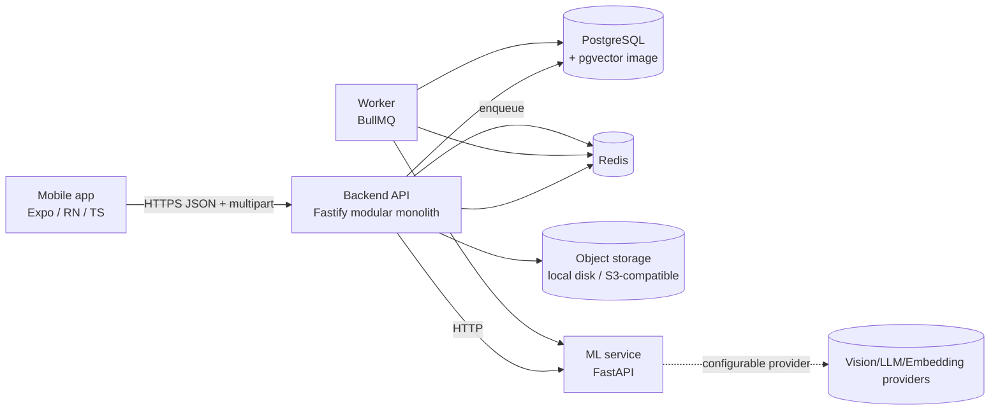
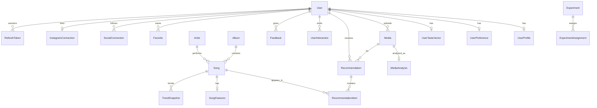

# VibePick Architecture

> Given this user's content, taste, moment and current trends, which songs will they most likely love using?

The repository was empty, so there are no architectural conflicts. Phase 1 is implemented; later phases are
designed-for but not built (see "Phases").

## 1. System overview



## 2. Technology choices

| Concern | Choice | Why |
|---|---|---|
| Mobile | React Native + Expo Router + TS, TanStack Query, Zustand, RHF + Zod | One codebase, native modules (image picker, secure store) |
| API | Fastify + Zod | Fast, schema validation, plugin encapsulation maps to modules |
| DB | PostgreSQL + Prisma | Relational integrity for interactions/experiments; migrations |
| Vectors | `Float[]` columns in Phase 1, pgvector (`vector(N)` + HNSW) in Phase 3 | Avoids premature infra; docker image already ships pgvector |
| Queue | BullMQ on Redis | Retries, delayed jobs, metrics |
| ML | Python FastAPI, provider interface | Python ML ecosystem; providers swappable via env |
| Ranking | Pure TypeScript engine, weights from config | Transparent V1; ML ranker (LightGBM) is a drop-in `Ranker` in Phase 4 |

LLM/vision is used only for semantic understanding, NL parsing and explanations. Ranking is deterministic code / ML.

## 3. Folder structure

```
vibePick/
  backend/                 Fastify modular monolith + worker
    prisma/schema.prisma, seed.ts
    src/
      config/              env, ranking config
      lib/                 prisma, redis, security, storage, errors
      modules/
        auth users profiles media music recommendations preferences
        interactions feedback trends instagram analytics notifications admin search
      engine/              pure recommendation engine (retrieval, filter, score, rerank, explain)
      worker/              BullMQ processors
  ml-service/              FastAPI service
    app/ (providers, routes, schemas)  tests/
  mobile/                  Expo Router app
    app/ (auth, onboarding, tabs, screens)  src/(api, components, store, theme)
  docs/                    API, DB, ML, etc.
  docker-compose.yml  .env.example  .github/workflows/ci.yml
```

## 4. Database ERD (core)



## 5. API list (v1)

See [API.md](docs/API.md). Highlights: `POST /api/v1/auth/{register,login,refresh,logout}`, `GET/PUT /me/preferences`,
`POST /media`, `GET /media/:id`, `POST /recommendations`, `POST /interactions`, `POST /feedback`,
`GET/PUT/DELETE /favorites`, `GET /history`, `GET /songs`, `GET /trends`, `DELETE /me`, `/health /ready /metrics`.

## 6. Mobile screen map

Splash → Onboarding (welcome, languages, vibes, artists, Instagram optional, privacy) → Login/Register →
Tabs: Home · Discover · History · Favorites · Profile. Flow: Home → Upload → Preview → Analysis → Context →
Results → Song details → Feedback. Settings: Account, Privacy, Notifications, Instagram, Data management.

## 7. Recommendation pipeline

```
User + media vibe + context
  → Retrieval (visual, taste, occasion, language, trending, history, discovery) ~500
  → Filtering (blocked/rejected songs, language hard-filter if set) ~100
  → Scoring (configurable weighted linear model, later ML) ~20
  → Re-ranking (artist cap, genre/mood/popularity diversity, discovery slot) 5–10
  → Explanations from actual signals
```
Details in [RECOMMENDATION_ENGINE.md](docs/RECOMMENDATION_ENGINE.md).

## 8. ML pipeline

Image → structured analysis + vibe vector + embedding (provider). Songs → Song DNA + embedding. Users → long/short
taste vectors with time decay. Interaction log → training set → LogReg → LightGBM, P(select). See [ML.md](docs/ML.md).

## 9. Data collection

Only: uploaded media (retention-limited), declared preferences, in-app interaction events, explicit feedback,
optional authorized Instagram data. No scraping, no passwords. See [SECURITY.md](docs/SECURITY.md).

## 10. Docker architecture

`postgres` (pgvector), `redis`, `ml-service`, `backend`, `worker` on one compose network. Mobile runs on the host.

## 11. Phases

0 Architecture · 1 Mobile MVP (rule-based) · 2 Personalization · 3 Embeddings · 4 ML ranker · 5 Trends · 6 Social ·
7 Instagram · 8 Video · 9 Advanced AI. Status in README.
